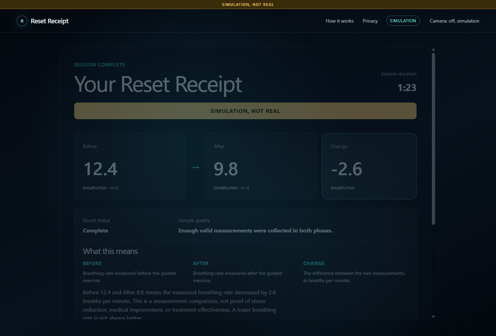

# Reset Receipt

*A guided breathing break with an honest measurement receipt.*

Reset Receipt is a Windows desktop app powered by Presage SmartSpectra. It guides you through a short breathing exercise and shows what the camera-based measurement actually observed—even when the evidence is incomplete.

**Windows · Electron · SmartSpectra SDK · v0.1.0**

## Download for Windows

**[Download Reset Receipt v0.1.0 for Windows x64](https://github.com/ScapeXYZ/reset-receipt/releases/download/v0.1.0/Reset-Receipt-0.1.0-Setup-x64.exe)**

[View the v0.1.0 GitHub Release](https://github.com/ScapeXYZ/reset-receipt/releases/tag/v0.1.0) · [Download SHA256SUMS.txt](https://github.com/ScapeXYZ/reset-receipt/releases/download/v0.1.0/SHA256SUMS.txt)

- Version: **v0.1.0**
- Platform: **Windows x64**
- Checksum: [SHA256SUMS.txt](https://github.com/ScapeXYZ/reset-receipt/releases/download/v0.1.0/SHA256SUMS.txt)
- Signing: the installer is currently **unsigned**, so Windows may show an unknown-publisher warning
- Simulation needs no camera or API key; real measurements require your own Presage API key

Installer and checksum links above were verified against the published v0.1.0 release assets.

## Preview



*Actual Reset Receipt interface captured from the credential-free simulation build. The on-screen **SIMULATION — NOT REAL** label identifies the displayed values as synthetic, not real measurements.*

## What Reset Receipt does

Reset Receipt combines a short guided breathing exercise with contactless breathing-rate measurement. After a session, it reports only what the accepted measurements support. If there is not enough reliable data for a comparison, the receipt is partial or unavailable rather than invented.

It is intended for adults who want a transparent wellness break. It is not a medical device and does not diagnose stress, prove relaxation, recommend treatment, or establish health improvement.

## Main features

- Adaptive natural-breathing baseline followed by an optional 45-second guided pacer.
- Contactless breathing-rate measurement through Presage SmartSpectra.
- Explicit camera consent and user-selected camera access.
- Complete, partial, and unavailable receipts based on accepted samples.
- Plain-English receipt explanations without medical or effectiveness claims.
- Credential-free, camera-free simulation clearly labelled **SIMULATION — NOT REAL**.
- Runtime Bring Your Own Key (BYOK); no developer credential is bundled.
- Aggregate-only PNG export for eligible receipts.
- Local packaged operation using `file://`, with no development server or localhost.

## How it works

1. Review the in-app guide and choose simulation or real measurement.
2. For a real session, enter your Presage API key, choose a camera, and provide explicit consent.
3. Start the session and breathe naturally while Reset Receipt collects a baseline.
4. Start the guided pacer manually and follow its inhale/exhale prompts.
5. Stop the session. Reset Receipt releases the camera and generates a receipt from accepted readings.
6. Review the result status and sample quality before interpreting the numbers.

The pacer is an instruction, not a measurement. Sessions have a visible three-minute maximum, and suspend, lock, camera failure, or sustained SDK frame loss triggers cleanup.

## How to understand your receipt

- **BEFORE:** breathing rate measured before the guided exercise.
- **AFTER:** breathing rate measured after the guided exercise.
- **CHANGE:** `AFTER − BEFORE`, in breaths per minute.
- **Sample quality:** whether enough valid measurements were collected.
- **Result status:** **Complete**, **Partial**, or **Unavailable**.

For example, BEFORE 12 and AFTER 10 means the measured breathing rate decreased by 2 breaths per minute. It does not prove reduced stress, medical improvement, or treatment effectiveness, and a lower breathing rate is not always better.

A comparison requires at least two accepted readings in each phase. Samples must have a valid SDK timestamp, confidence of at least 45, stable status, and a value from 4 to 45 breaths per minute. If those requirements are not met, Reset Receipt shows a partial or unavailable result and does not fabricate BEFORE, AFTER, or CHANGE.

## Installation and first-time setup

1. Download `Reset-Receipt-0.1.0-Setup-x64.exe` and `SHA256SUMS.txt` from the v0.1.0 release.
2. In PowerShell, run:

   ```powershell
   Get-FileHash .\Reset-Receipt-0.1.0-Setup-x64.exe -Algorithm SHA256
   ```

3. Compare the output with `SHA256SUMS.txt`.
4. Run the installer. Because it is unsigned, Windows may display an unknown-publisher warning; do not bypass organizational security policy.
5. Launch **Reset Receipt** from the Start menu or desktop shortcut.
6. Choose simulation for a credential-free tour, or configure BYOK for real measurement.

The installed app launches without PowerShell, localhost, or a development server. Uninstall it from **Settings → Apps → Installed apps → Reset Receipt → Uninstall**. See [Windows installation](docs/INSTALLATION.md).

## BYOK configuration

Real SmartSpectra sessions use your own Presage API key:

1. Obtain and manage a key through your Presage account.
2. Open **Start a reset** and enter it in the password-masked **SmartSpectra API key** field.
3. Select a camera, review the disclosure, provide consent, and start the session.

The key is held only in renderer memory for the current app run and passed directly to the SmartSpectra SDK for authentication. Reset Receipt does not send it through app-defined IPC or write it to local storage, files, logs, diagnostics, receipts, or exports. Closing the application clears the in-memory value. Never place a key in `.env`, source code, screenshots, issue reports, or commits.

## Simulation versus real measurements

| Simulation | Real measurement |
| --- | --- |
| No API key | User-provided Presage API key |
| No camera access | Explicit consent and camera permission |
| Synthetic signals | SmartSpectra camera-derived signals |
| No Presage credits | May consume Presage credits |
| Always labelled **SIMULATION — NOT REAL** | Receipt identifies SmartSpectra measurement |

Simulation is useful for exploring the workflow and testing UI behavior. Its numbers are illustrative and must never be presented as real sensing evidence.

## Privacy and camera handling

Reset Receipt does not implement video or frame recording. Camera frames and raw session samples are processed in memory, bounded during the session, and released or cleared during cleanup. The app stores only the guide-seen flag and selected camera ID in local storage; it does not store the API key.

Camera permission is restricted to video access from the application’s own renderer. Popups and renderer navigation are denied, context isolation and sandboxing are enabled, production DevTools are disabled, and no arbitrary credential IPC is exposed.

SmartSpectra still authenticates with Presage. Presage-side processing, retention, and network behavior are governed by Presage and have not been independently verified by this project. Read [Privacy and data handling](docs/PRIVACY.md).

## Supported platforms and requirements

- Verified platform: Windows x64.
- Camera for real measurement; no camera for simulation.
- Presage account, API key, and available credits for real measurement.
- Camera delivery of at least 25 FPS for SmartSpectra; the app rejects a preflight below 24 FPS.
- Recommended framing: head, shoulders, and upper chest visible with stable, even lighting.

macOS, Linux, Windows on ARM, code signing, and automatic updates are not supported by v0.1.0.

## Development setup and reproduction instructions

The verified release toolchain used Node.js 24.14.1 and npm 11.18.0 on Windows.

```powershell
git clone https://github.com/ScapeXYZ/reset-receipt.git
cd reset-receipt
npm install
npm run typecheck
npm test -- --maxWorkers=1
npm run build
```

Run the credential-free source simulation:

```powershell
npm run dev:sim
```

Run the development application for an authorized real session:

```powershell
npm run dev
```

Enter the API key only in the in-app BYOK field. To reproduce Windows artifacts and checks:

```powershell
npm run dist:win
npm run inspect:release
npm run checksum:release
npm run verify:bundle-secrets
npm run smoke:packaged
```

Do not start a real SDK session unless camera use and Presage credit consumption are authorized.

## Tests and release verification

The v0.1.0 acceptance run verified all 10 public-release gates, including:

- TypeScript typecheck, 147 automated tests, and production build.
- Full Git-history and compiled-output Gitleaks scans.
- Production credential-canary and installer-content inspection.
- Credential-free packaged simulation.
- Installed-app launch without localhost or a terminal.
- One authorized packaged real-SDK BYOK session, camera access, measurement reception, and camera cleanup.
- Official NSIS installation and uninstallation.
- Electron IPC, CSP, navigation, and permission review.
- README, privacy documentation, checksum, and download instructions.

See [Windows release acceptance](docs/RELEASE_ACCEPTANCE.md) for evidence and boundaries.

## Known limitations

- The v0.1.0 installer is unsigned.
- Users must obtain, protect, and revoke their own Presage API keys.
- No full real-SDK BEFORE/AFTER receipt has been verified; authorized real runs produced partial results.
- Camera preflight cannot guarantee sustained SDK processing performance.
- Presage-side data handling has not been independently audited by this project.
- The optional abdomen signal is not required for the receipt.
- This prototype has not completed a formal accessibility, clinical, or regulatory review.

## Documentation

- [Windows installation](docs/INSTALLATION.md)
- [Privacy and data handling](docs/PRIVACY.md)
- [SDK integration](docs/SDK_INTEGRATION.md)
- [Claim-to-evidence register](docs/CLAIMS.md)
- [Release acceptance](docs/RELEASE_ACCEPTANCE.md)
- [Live-test runbook](docs/R1-LIVE-TEST-RUNBOOK.md)
- [MIT License](LICENSE)

## Presage hackathon information

Reset Receipt was created for the Presage SmartSpectra challenge as a consent-first example of honest physiological-sensing UX. It integrates the real SmartSpectra SDK while keeping simulation unmistakably separate from measurement evidence. The project emphasizes transparent sample-quality gates, non-medical language, runtime BYOK, and explicit camera control.

Submission details and challenge evidence are tracked in the [submission checklist](docs/SUBMISSION_CHECKLIST.md).
