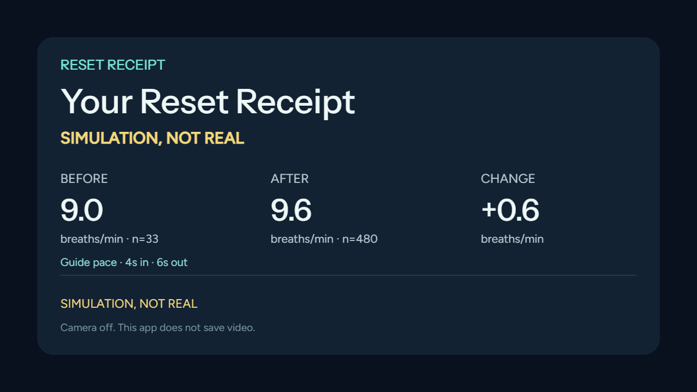

# Windows release acceptance

Status date: 2026-11-18. No artifact has been published or uploaded.

The image above is the existing release-checklist reference, not product or measurement evidence. The actual rendered product screenshot is [reset-receipt-result.png](screenshots/reset-receipt-result.png) and is explicitly labeled simulation.

| # | Public-release gate | Status | Evidence |
| --- | --- | --- | --- |
| 1 | Full Git-history secret scan | PASS | `gitleaks git --redact --no-banner` completed with no leaks on 2026-11-18. |
| 2 | No API key or sensitive diagnostics in installer | PASS | Compiled-output verifier, unpacked `app.asar`/loose-file inspection, NSIS 7-Zip listing/extraction inspection, credential canary, and Gitleaks scans found no key or forbidden private paths. |
| 3 | BYOK distribution approved by Presage | PASS | Task owner records Bobby/Presage approval for packaged-app distribution with user-provided keys. |
| 4 | App launches without terminal or localhost | PASS | The installed per-user app and both created shortcuts launched normally. Automated smoke against the installed executable verified `file://`, empty host, and reached the UI without PowerShell or a development server. |
| 5 | Simulation works without credentials | PASS | Installed-app smoke selected simulation, verified no password field, reached Live session, and showed `Camera: off, simulation`; source-only screenshot bundle also excludes SDK and camera APIs. |
| 6 | Real SDK works in packaged build with authorized credential | PASS | One explicitly authorized installed-app session used runtime BYOK and real SDK source. The SDK delivered 2,993 frames, produced 21 unique rate samples and 147 chest samples, accepted 5 post-pacer readings, and reported no SDK errors. The displayed receipt was Partial: baseline ended at its cap with 0 accepted baseline readings, so the app did not invent a comparison. |
| 7 | Camera permissions and cleanup work | PASS | The same single installed-app session recorded one camera settings event, one FPS preflight, no camera stall, one user stop, and one `media-tracks-stopped` event 21 ms after stop. No Reset Receipt process remained after exit. |
| 8 | IPC, CSP, and navigation security reviewed | PASS | No credential IPC exists; context isolation, sandbox, no Node integration, production DevTools off, CSP, denied navigation/popups, scoped camera permission policy, and typed diagnostic payload validation were reviewed. |
| 9 | Installer and uninstaller tested | PASS | Authorized per-user installation completed with exit code 0 and installed launch/shortcuts/simulation were verified. The registered official NSIS uninstaller later completed with exit code 0; the install directory, executables, uninstall registration, Start-menu shortcut, desktop shortcut, and processes were confirmed removed. Retained per-user profile data is documented below. |
| 10 | README, privacy, checksum, and download instructions ready | PASS | README embeds the validated simulation screenshot; `PRIVACY.md`, `INSTALLATION.md`, this acceptance record, and `release/SHA256SUMS.txt` are present. Artifact publication remains approval-gated. |

Verified gates: **10 of 10**. Blocked gates: **none**.

## Installation evidence — 2026-11-18

- Installer checksum matched `release/SHA256SUMS.txt` before execution; the installer is unsigned as documented.
- Silent per-user NSIS installation returned exit code 0 and installed version 0.1.0 under `%LOCALAPPDATA%\Programs\Reset Receipt`.
- Windows registered `Uninstall Reset Receipt.exe` for the current user.
- Start-menu and desktop shortcuts both targeted the installed executable and launched it successfully.
- Installed-app smoke verified local `file://` loading, no localhost, credential-free simulation, `SIMULATION, NOT REAL`, and `Camera: off, simulation`.
- No real SDK session, API-key entry, camera capture, credit consumption, or uninstall occurred during this stage.

## Authorized real-SDK evidence — 2026-11-18

- Exactly one installed-app real session ran with the user's runtime-entered Presage credential; the credential was never supplied to the test harness or report.
- The 108-second session delivered 2,993 frames and produced 21 unique breathing-rate samples plus 147 chest samples, with no SDK error or camera stall.
- Baseline collection reached its cap with 0 accepted baseline readings. Five readings were accepted after the pacer began. The actual displayed receipt status was **Partial**, consistent with the minimum-sample rules; no Before/After comparison was fabricated.
- Camera setup and FPS preflight were recorded. Stop was recorded once, media tracks were recorded stopped once 21 ms later, and no application process remained after exit.
- The sanitized evidence file contained no credential-bearing field names. All six application-profile files modified during the session passed redacted Gitleaks and targeted credential-field scans with zero findings.
- A broader profile scan reported six redacted `generic-api-key` matches in Chromium cache/Local State files that all predated this session (2026-11-14 through 2026-11-17) and were not modified by it. They are retained as a documented pre-existing-profile caveat, not attributed to the runtime credential.

## Uninstallation evidence — 2026-11-18

- Before uninstall, `release/Reset-Receipt-0.1.0-Setup-x64.exe` and `release/SHA256SUMS.txt` were present and the installer SHA-256 matched the recorded checksum.
- The registered per-user NSIS uninstaller ran with `/currentuser /S` and returned exit code 0.
- The installed application directory, application executable, uninstaller executable, and current-user uninstall registry entry were removed.
- No Reset Receipt Start-menu shortcut, desktop shortcut, or running process remained.
- The uninstaller retained `%APPDATA%\Reset Receipt`: 523 files totaling 39,656,358 bytes. Top-level retained directories are Chromium/Electron and SDK profile data: `blob_storage`, `Cache`, `Code Cache`, `DawnGraphiteCache`, `DawnWebGPUCache`, `GPUCache`, `Local Storage`, `Network`, `Session Storage`, `Shared Dictionary`, and `SmartSpectraSDK`. This data was identified but not deleted or displayed.
- After uninstall, the installer and checksum remained present and still matched; the source repository `.git` directory and `package.json` also remained intact.

## Remaining release hardening

The ten defined acceptance gates are verified. The installer remains unsigned; add Authenticode signing and repeat checksum, Gitleaks, installation, real-session, and uninstallation checks before public distribution.
